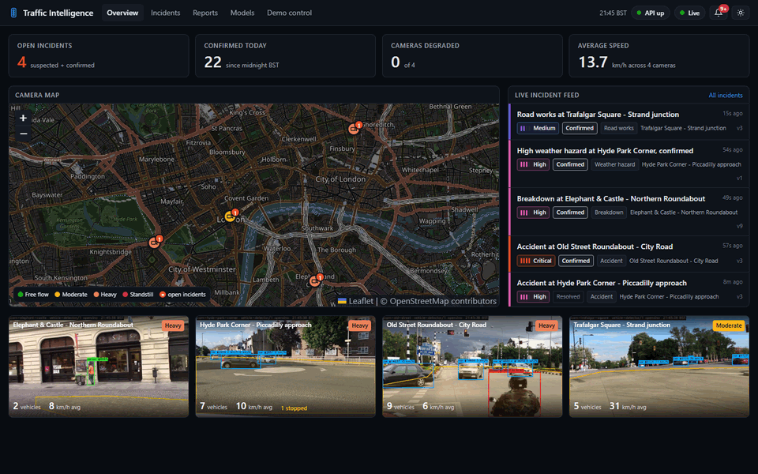
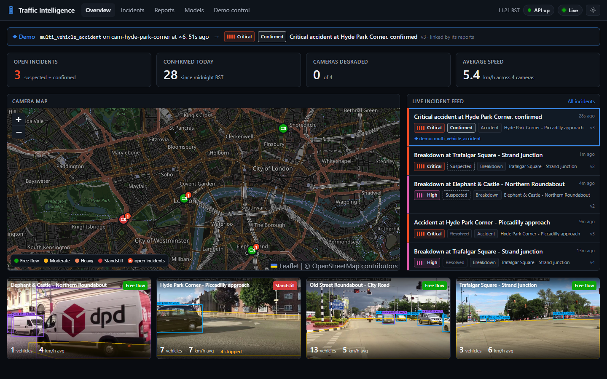
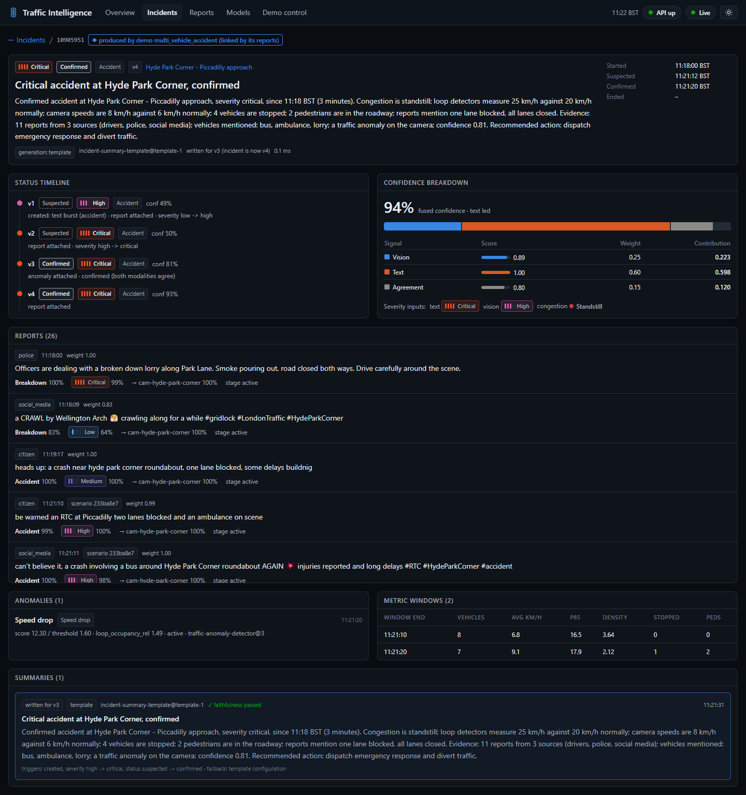
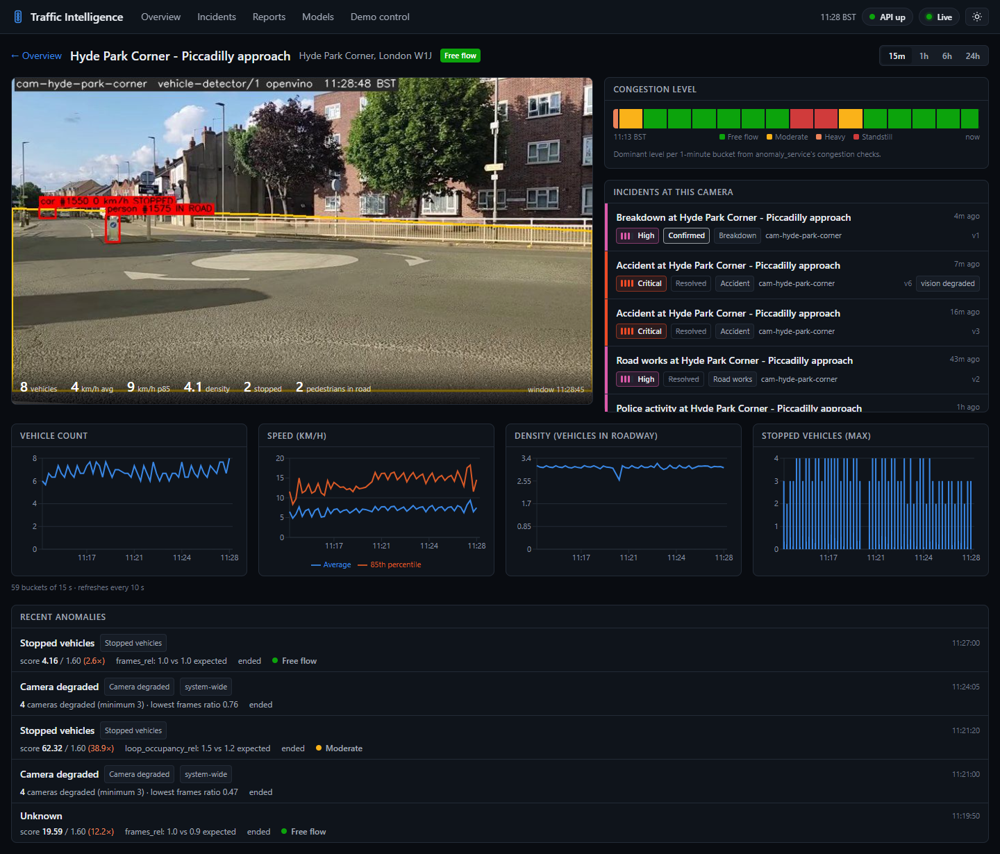
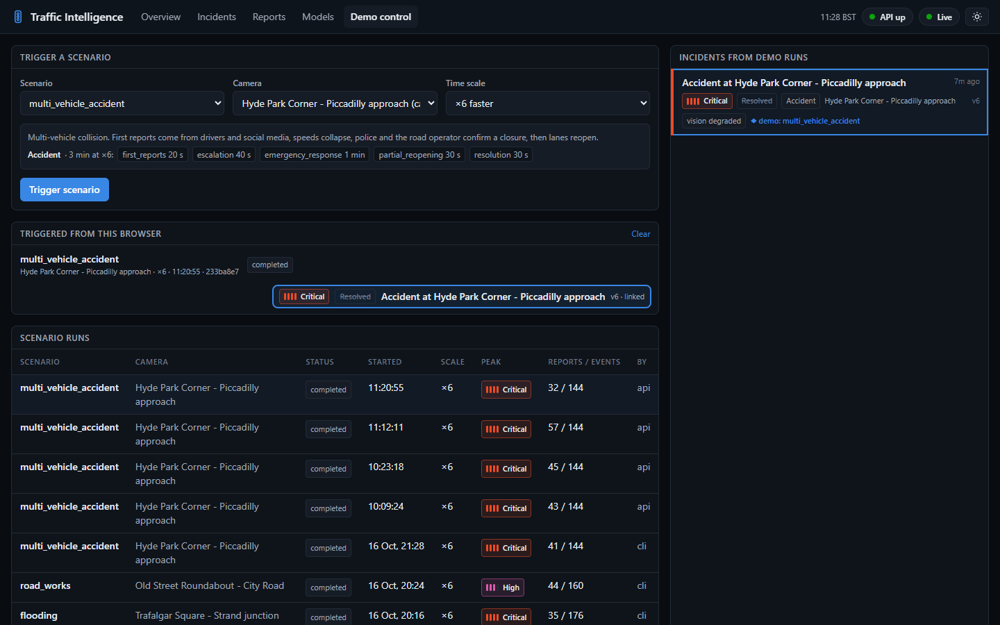
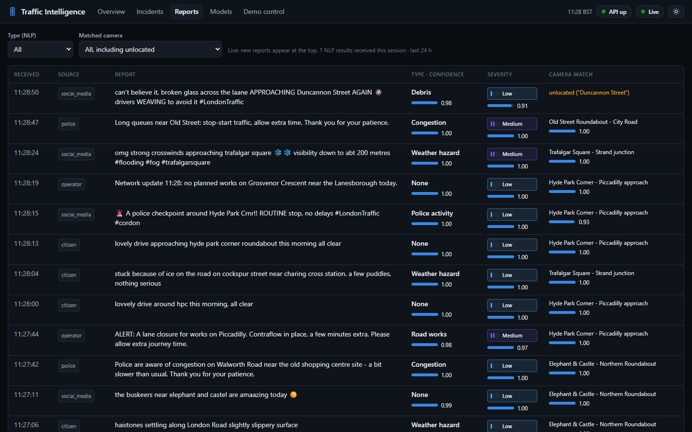
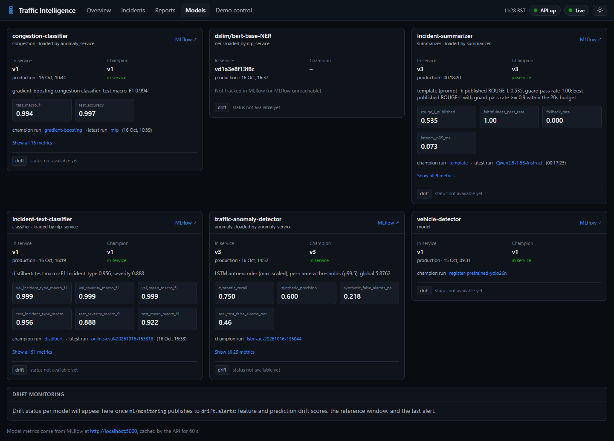
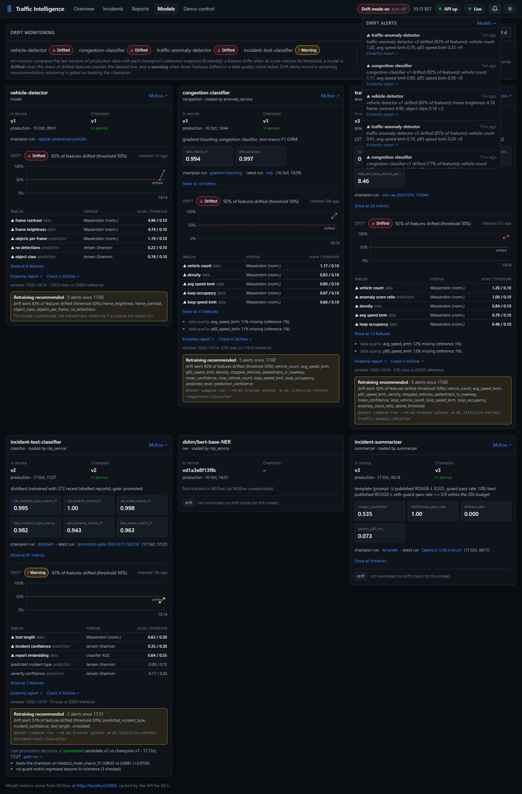
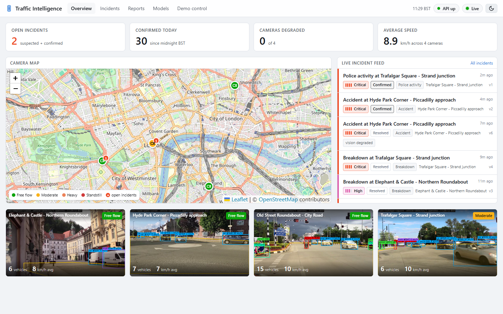
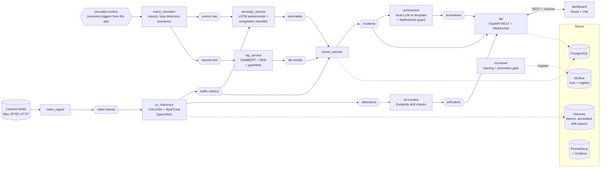

# Real-Time Multimodal Traffic Intelligence Platform

[](https://github.com/karthika000/traffic-intelligence-platform/actions/workflows/ci.yml)
[](LICENSE)

Traffic operators watch dozens of camera feeds while reports of crashes, breakdowns and floods come in from police, drivers and social media. This platform does the cross-checking for them, in real time and on a laptop CPU. It detects and tracks vehicles in live video (YOLO + ByteTrack, OpenVINO), learns each camera's normal traffic and flags departures from it (LSTM autoencoder), and classifies and geolocates free-text reports (DistilBERT, NER and fuzzy gazetteer matching). It fuses both into incidents with an explainable confidence and a lifecycle, writes operator briefings with a local language model behind a faithfulness guard, and streams everything to a React dashboard. Ten services communicate over Kafka with typed, validated messages. Every model is tracked in MLflow, monitored for drift with Evidently, and replaced only through an evaluation gate. A one-command demo and an end-to-end test exercise the whole pipeline.



*About a minute into the end-to-end test (headless Edge, one frame every 4 seconds, sped up about 9×). Four scenarios run at once and each has a confirmed incident in the live feed and a badge on the map, while the four annotated streams play. Then one incident's detail page: its template summary, the status timeline across versions, and the confidence breakdown, with vision down-weighted because that camera reported itself degraded. Times are in Europe/London.*

## Screenshots

| | |
| --- | --- |
|  **Overview** during the demo incident: KPIs, the map with an open-incident badge, the live feed with the incident highlighted, and the four annotated streams. |  **Incident detail:** the latest summary and its generation path, the status timeline across versions, the confidence breakdown, and the linked reports, anomalies, metric windows and summaries. |
|  **Camera detail:** the live stream, the congestion timeline in 1-minute buckets, the metric charts and recent anomalies. |  **Demo control:** trigger a scenario on a camera, follow the run and the incident it produced. |
|  **Reports:** the live report feed with NLP type, severity and camera match, each with its confidence. |  **Models:** per model the version in service, the champion and its MLflow metrics, drift status and drift share over time, per-feature scores, the Evidently report, the retraining recommendation and the last promotion decision. |
|  **Drift detected:** 12 minutes into drift mode (night frames, slang reports). Three models have drifted; the text classifier, retrained on slang, only warns. |  **Light mode.** |

## Architecture



Rectangles are services, hexagons are Kafka topics, cylinders are stores. Not drawn, to keep it legible: every service writes what it produces to PostgreSQL; services load their `@champion` models from MLflow; Prometheus scrapes every service; the api's live consumer also reads `traffic.metrics`, `nlp.results` and `anomalies`, and the api publishes the scenario triggers on `simulator.control`; ml-monitor consumes `drift.alerts` too, to record retraining recommendations. Message schemas, topics and design decisions are in [docs/ARCHITECTURE.md](docs/ARCHITECTURE.md).

## How it works

**Ingest.** `video_ingest` runs one worker per camera in the `cameras` table. It reads a file (looped, in real time), an RTSP or an HTTP stream, samples 5 frames a second, writes each as a JPEG to a shared volume, and publishes a reference to it on `video.frames`. A failing source retries with backoff without affecting the others. `event_simulator` supplies what a city would: loop-detector readings every 15 s, weather, and a steady stream of free-text reports in four writing styles (driver, police, operator, social media). Scenarios (`multi_vehicle_accident`, `broken_down_lorry`, `flooding`, `road_works`) play a timeline of phases that change the loop readings and emit matching reports, and their ground truth is recorded separately for evaluation. [More](docs/ARCHITECTURE.md#video-ingest)

**Computer vision.** `cv_inference` detects vehicles and pedestrians with YOLO26n (exported to OpenVINO for CPU) and tracks them with ByteTrack. With each camera's roadway polygon and pixel scale it measures speeds, flags stopped vehicles and pedestrians in the road, and every 5 s publishes per-camera metrics: unique vehicles, mean and 85th-percentile speed, density, stopped vehicles. To stay real time it keeps only the newest waiting frame per camera and drops frames older than 5 s. [More](docs/ARCHITECTURE.md#cv-inference)

**Anomaly detection.** `anomaly_service` joins each camera's metrics with its loop-detector readings and scores the last minute every 5 s with two MLflow champions:

- a congestion classifier (free flow to standstill);
- an LSTM autoencoder whose inputs are relative to the camera's own last 10 minutes. Its score is the larger of a reconstruction part (sudden change) and a level part (sustained deviation), each feature scaled by that camera's normal error.

How alerts work:

- **Warm-up:** a camera raises no alert until its baseline is full (10 minutes), and is then calibrated from its own history if the model never saw it.
- **During an alert:** the baseline is frozen, so a long incident doesn't become the new normal. The alert ends when the score clears or the traffic has recovered.
- **Explanations:** hints such as `speed_drop` and `stopped_vehicles` say what fired.
- **Pipeline problems:** when several cameras degrade at once, one system-wide alert replaces many false traffic ones.

[More](docs/ARCHITECTURE.md#anomaly-service)

**Language.** `nlp_service` classifies each report's incident type (8 classes) and severity with a two-headed DistilBERT, extracts places, vehicles, lanes and times (BERT NER plus rules), and matches the report to a camera by fuzzy matching against a gazetteer of names, streets, landmarks, abbreviations and misspellings. Reports that mean "it's over" are tagged `cleared`. [More](docs/ARCHITECTURE.md#nlp-service)

**Fusion.** `fusion_service` groups vision and text evidence per camera within a 10-minute window and runs a lifecycle for each incident:

- **Suspected** when one modality fires: a traffic anomaly, or a burst of 4 same-type reports from 2 sources within 3 minutes.
- **Confirmed** when both modalities are reasonably strong and agree, or one is very strong.
- **Resolved** when the anomaly is over (or its traffic has recovered and a clearing report arrived) and camera speed is back near its pre-incident baseline.

The fused confidence is stored as its parts (vision, text, agreement), each with its sub-scores, and every published version records why it was published. Reports with no camera match can still join an incident whose reports name the same place. [More](docs/ARCHITECTURE.md#fusion-service)

**Summaries.** The `summarizer` builds a fact-only context for each incident version: camera, type, severity, duration, loop speed against its pre-incident baseline, report sources, and the confidence breakdown. It then writes a headline and 2–4 sentences with a local model or a deterministic template. A faithfulness guard rejects any output that names a number, time, place or vehicle that isn't in the facts, or contradicts them; the template is used instead and the rejection is recorded. Which configuration serves is decided by evaluation (ROUGE-L, guard pass rate, CPU latency) and registered in MLflow. [More](docs/ARCHITECTURE.md#summarizer)

**API.** `api` (FastAPI, async SQLAlchemy) serves:

- cameras, incidents with all their versions and evidence, reports, analytics, models with their MLflow metrics, drift status and history, and scenario control, in the shared message schemas;
- MJPEG streams of the annotated frames;
- a WebSocket, fed by its own Kafka consumer, that pushes every incident, summary, anomaly, NLP result, metrics window and drift alert, filtered per client and with backpressure.

[More](docs/ARCHITECTURE.md#api)

**Dashboard.** A React 18 + TypeScript app with these pages:

- **Overview:** KPIs, a Leaflet map coloured by congestion, the live incident feed, four live annotated streams.
- **Camera:** metric charts.
- **Incidents** and **Incident detail:** a filterable list; the timeline, confidence breakdown, evidence and summaries.
- **Reports**, **Models** (drift and promotion), and **Demo control**.

One WebSocket connection feeds a Zustand store in 250 ms batches, and the dashboard re-syncs from REST after a reconnect. [More](docs/ARCHITECTURE.md#dashboard)

**ML lifecycle.**

- **Training:** every model is trained and evaluated in the `ml-trainer` container and logged to MLflow, with versioned datasets.
- **Promotion:** a retrained candidate becomes `@champion` only if it beats the champion on the same held-out data without regressing on guard metrics.
- **Drift:** `ml-monitor` checks every champion every 15 minutes against a reference snapshot (data, prediction and data-quality drift, time-of-day aware, with Evidently). It publishes alerts and records a retraining recommendation.
- **Drift mode:** a switch degrades the video (night, fog) and the report language (slang), to demonstrate the loop end to end.

[More](docs/ARCHITECTURE.md#ml-lifecycle)

**Observability.** Every service exposes Prometheus metrics: messages in and out, handler time, message age per stage, consumer lag, errors, model inference latency, open incidents, drift status, and API request rate and latency. A provisioned Grafana dashboard shows them. Health checks are heartbeats from the work itself, so a container is only healthy when it is processing. [More](docs/ARCHITECTURE.md#observability)

## Results

Measured on one laptop: a Core Ultra 5 225H, with Docker Desktop's VM at 14 vCPUs and 7.5 GB. All four cameras play 480p looped videos, and every model was trained by `run_demo.ps1` on a fresh install (2026-10-18). These are measurements of this demo setup, not benchmarks on real city traffic; see [Model limitations](#model-limitations).

**Real-time pipeline** (Prometheus, 45 minutes of normal operation, four cameras; p50 / p95):

| Measure | Value |
| --- | --- |
| CV throughput on CPU | 17.4 frames/s analysed across the four cameras, of 20 sampled (5 per camera); the rest are superseded by a newer frame of the same camera, under 0.1% go stale |
| Vehicle detection (YOLO26n, 480 px, OpenVINO, 6 threads) | 45 ms / 96 ms per frame |
| Capture to published detection | 0.16 s / 0.30 s |
| Scoring one camera every 5 s (congestion classifier + autoencoder) | 77 ms + 61 ms / 181 ms + 98 ms |
| Report analysis per batch (usually one report): DistilBERT + NER | 78 ms + 178 ms / 239 ms + 434 ms |
| Message age on arrival at fusion: `traffic.metrics` (after the window closes) / `nlp.results` | 0.31 s / 0.76 s; 26 ms / 50 ms |
| Worst consumer lag, any group or partition | 1 message |

**End-to-end scenarios** (`e2e_test.ps1`, all four at once at ×6, times from the trigger):

| Scenario (length at ×6) | Camera | Suspected | Confirmed | First summary | Resolved | Resolved, before the fixes |
| --- | --- | --- | --- | --- | --- | --- |
| broken_down_lorry (2 min 40 s) | Elephant & Castle | 24 s | 35 s | 34 s | 2 min 19 s | 2 min 40 s |
| flooding (3 min 40 s) | Hyde Park Corner | 43 s | 45 s | 55 s | 3 min 25 s | **14 min 39 s** |
| multi_vehicle_accident (3 min) | Old Street | 28 s | 28 s | 39 s | 2 min 30 s | 3 min 13 s |
| road_works (3 min 20 s) | Trafalgar Square | 38 s | 40 s | 51 s | 3 min 35 s | 2 min 42 s |

The table is the final run (2026-10-19), on the code as committed. Every scenario passed in every run after the fixes below: confirmed with the right type, summarised, served by the API, resolved.

- **Vision:** an anomaly on each scenario's camera 20 to 77 s after the trigger, through the loop-detector features.
- **Resolution:** with a clearing report, every incident resolved within seconds of the scenario's end.
- **One exception, now fixed:** an earlier run's flooding scenario sent no clearing report at all. Its 30-second final phase at ×6 drew none from the Poisson arrivals, so that incident resolved by the 300-second quiet rule after 10 min 52 s. A phase that announces the end now sends its first report as it starts. Before the fixes, flooding resolved after **14 min 39 s**. A traffic anomaly on Hyde Park Corner stayed above its clear level for 22 minutes because that camera was scored against synthetic error scales, and fusion doesn't resolve while an anomaly is active.

**False alarms in normal operation** (the same stack and models; operating time only, outside scenario runs and their 5-minute aftermath and outside warm-ups; the laptop slept twice in the after period, so it is short):

| | Before the fixes (15.6 camera-hours) | After (4.9 camera-hours) |
| --- | --- | --- |
| Traffic anomaly alerts per camera-hour | 3.3 (9.0 on Elephant & Castle) | 0.4 (2 short loop-detector blips right after the host resumed from sleep) |
| Incidents suspected per camera-hour | 0.90 | 1.4 (all text-only: bursts of background reports) |
| Incidents confirmed per camera-hour | 0.77 (mostly vision false alarms plus a background report) | 0.2 (one, text-only: 15 background reports reached the strong-text bar) |

The fixes:

- **No alerts until a camera has a full baseline,** a 10-minute warm-up.
- **Calibration from each camera's own warm-up.** A fresh install's anomaly model has only synthetic calibration, so every real camera was scored against other cameras' noise: Elephant & Castle sat above its threshold in 55% of windows, Trafalgar Square in 91%.
- **Elephant & Castle ignores its own speed and stopped-vehicle signals.** The footage pans, so camera motion reads as traffic.
- **Alerts end when traffic recovers.**

A replay of the same 5 hours of metrics through the champion shows the effect in isolation (`anomaly_service/calibration.py`):

- Global calibration: 14 false alarms per hour on Elephant & Castle, 3.4 on Hyde Park Corner.
- With warm-up calibration and the per-camera setting: 0 on every camera, for warm-ups starting at five different points.
- The loop-detector incidents still score 3.4 to 3.7× the threshold on the three scenarios that move the loops.

**Models** (held-out test sets, as trained by `run_demo.ps1`; details in [ARCHITECTURE.md](docs/ARCHITECTURE.md#congestion-and-anomaly-models)):

| Model | Test data | Result |
| --- | --- | --- |
| `incident-text-classifier` (DistilBERT, 2 heads) | 1,000 reports with held-out phrasings and place forms | type accuracy **0.955** (macro-F1 0.956); severity accuracy **0.891** (macro-F1 0.888); 8 ms per report. The TF-IDF baseline: 0.900 / 0.792. |
| Camera matching (gazetteer + fuzzy) | the same reports | accuracy 0.871; precision 0.999 when it returns a camera |
| `traffic-anomaly-detector` (LSTM autoencoder) | synthetic test episodes | recall 0.75, precision 0.61, 0.20 false alarms per hour, median delay 0 s. Recall is 1.0 on incidents, camera failures and sensor dropouts, 0.67 on pedestrians in the road, and 0 on slow congestion build-ups (see the limitations) |
| `congestion-classifier` (gradient boosting) | synthetic test windows | macro-F1 0.991, against rule-derived labels (see the limitations) |
| `incident-summarizer` | 40 contexts with reference summaries | the template, champion: ROUGE-L 0.568, guard pass rate 1.00, under 1 ms. flan-t5-small: 0.436 published, with half its outputs replaced by the template, at 0.8 s p95 |
| `vehicle-detector` (YOLO26n, pretrained) | not evaluated here | drift-monitored: frame brightness and contrast, confidence, objects per frame |

**Drift monitoring in practice.** On this install ml-monitor reports both traffic models as *drifted* and the text classifier as *warning* against their references, while the detector is *ok*. The traffic models were trained on synthetic data only, and real cameras differ from it. Each drifted check records a retraining recommendation. The drift demo (night frames and slang reports) and a retrain through the promotion gate, on an earlier install, are in [ARCHITECTURE.md](docs/ARCHITECTURE.md#drift-demo): the text classifier went from 0.888 to 0.964 mean macro-F1 and was promoted.

## Model limitations

- **The congestion classifier learns rules, not ground truth.** Its labels are derived by rule. Real data gets weak labels from thresholds on speed ratio, density ratio and stopped vehicles (`ml/labels.py`), and synthetic data is labelled by the same rule applied to the generator's noise-free state. Its near-perfect test scores (macro-F1 about 0.99) mostly show that it reproduces that rule. They are not evidence of accuracy against human-labelled traffic states, and there is no such evaluation yet.
- **A fresh install's traffic models have never seen a real camera.** `run_demo.ps1` trains them before any real data exists, so they learn from synthetic series only. The warm-up calibration gives each camera its own scales and threshold from ten minutes of its own footage. Retraining on a few days of real data (`ml.lifecycle.retrain`, through the promotion gate) would give each camera a calibration from far more data; until then a ten-minute sample has to stand in for it.
- **Simulated incidents happen only in the loop-detector and text channels.** The camera metrics come from looped sample videos and the loop-detector readings from the event simulator, so a simulated crash never appears in the video. Vision detects the scenarios through the loop features, and a scenario with a weak effect on the loops (the broken-down lorry) is mostly caught by the reports.
- **The anomaly baseline is short-term.** The detector compares each camera with its own last ~10 minutes, frozen while an alert is active. It doesn't know what is normal for the time of day. A slowdown that builds over more than about 10 minutes, or an incident during an already-congested peak, is detected late or not at all. A time-of-day baseline needs several weeks of real data per camera.
- **Footage that moves defeats the speed estimate.** Speeds come from a fixed polygon and pixel scale. On a panning view (Elephant & Castle), camera motion looks like traffic, so that camera ignores its own speed and stopped-vehicle signals and relies on its other signals and its loop detector.
- **Background chatter can open text-only incidents.** The simulator's background reports mention every incident type. Occasionally four of one type from two sources land on one camera within three minutes, which is exactly the text-burst rule, and a suspected incident opens. These are rarely confirmed, because text alone has to reach 0.9, but they count in the false-incident rate above.
- **The text models have only seen simulated reports.** Reports come from templates with injected noise. The test split's unseen phrasing is a fairer check than validation, but real reports will be more varied, and accuracy on them is unknown until real labelled reports exist.
- **Camera matching only knows the gazetteer.** Places outside it (side streets, new landmarks) get no camera, and nothing is geocoded. The camera a report is tagged with by its source (the simulator sets one) is recorded for evaluation, but never used for matching.
- **Summaries are short and template-like.** The local models are small, and the guard rejects anything it can't verify; on CPU the template wins the evaluation. ROUGE-L is measured against references written from the same facts, so it rewards fact coverage, not prose quality.

## Tech stack

| Area | Technologies |
| --- | --- |
| Messaging | Apache Kafka 3.8 (KRaft), confluent-kafka, Pydantic v2 schemas, dead-letter topics |
| Computer vision | Ultralytics YOLO26n, ByteTrack, OpenVINO, OpenCV |
| Machine learning | PyTorch (LSTM autoencoder, MLP), scikit-learn (gradient boosting, TF-IDF + logistic regression), Hugging Face Transformers (DistilBERT, BERT NER, flan-t5, Qwen2.5), RapidFuzz |
| ML lifecycle | MLflow (tracking, registry, pyfunc), Evidently (drift), a custom promotion gate |
| Storage | PostgreSQL 16, SQLAlchemy 2 (sync and async), Alembic, psycopg 3 |
| API | FastAPI, Uvicorn, WebSocket, MJPEG streaming |
| Frontend | React 18, TypeScript, Vite, TanStack Query, Zustand, Leaflet, Recharts, Tailwind CSS, Vitest |
| Observability | Prometheus, Grafana, structured JSON access logs, heartbeat health checks |
| Delivery | Docker Compose, PowerShell scripts, GitHub Actions, ruff, mypy, pytest |

## Project structure

```
services/
  video_ingest/       camera workers: read, sample, store frames, publish
  event_simulator/    background reports, loop detectors, weather, scenarios (+ scenarios/*.yaml)
  cv_inference/       detection, tracking, zones, speed, metric windows
  nlp_service/        incident classification, entities, camera matching
  anomaly_service/    congestion and anomaly scoring, alerts, warm-up calibration
  fusion_service/     incident correlation, confidence, lifecycle (engine.py has no I/O)
  summarizer/         fact context, generation, faithfulness guard
  api/                FastAPI REST, WebSocket, frames
shared/               traffic-common: settings, schemas, Kafka clients, telemetry, DB models, migrations
ml/                   features, labels, datasets, models, training, evaluation, summarisation,
                      drift monitoring, promotion gate (+ the ml-trainer / ml-monitor image)
dashboard/            React + Vite + TypeScript
infra/                MLflow image, Postgres init, Prometheus config, Grafana provisioning + dashboard
scripts/              run_demo, e2e_test, reset, up, down, logs, create_topics, test (PowerShell);
                      sample videos, zone configs, e2e checker (Python)
tests/                pytest suite (+ the Dockerfile CI and test.ps1 run it in)
docs/                 ARCHITECTURE.md, DEVELOPMENT.md, screenshots, demo GIF
.github/workflows/    CI
```

## Quick start

You need Windows with Docker Desktop (WSL 2 backend, at least 6 GB of memory for its VM, 8 recommended, and about 20 GB of disk) and Git. Everything else runs in containers.

```powershell
git clone https://github.com/karthika000/traffic-intelligence-platform.git
cd traffic-intelligence-platform
.\scripts\run_demo.ps1                              # everything, from a fresh clone
.\scripts\run_demo.ps1 -Scenario multi_vehicle_accident   # ...and trigger an incident after the warm-up
```

`run_demo.ps1` does the following:

1. Checks the prerequisites, including that every host port is free.
2. Builds the images and starts the infrastructure.
3. Creates the topics, migrates the database, and downloads the sample videos.
4. Trains and registers every model that has no champion yet: about 10 minutes for DistilBERT on CPU, or seconds with `-QuickModels`.
5. Starts every service, waiting until each is healthy, and opens the dashboard.

From a clean state it takes about 20 minutes, and a re-run takes under a minute. When it finishes it prints every URL:

| Open | URL |
| --- | --- |
| Dashboard | <http://localhost:5173> (Demo control triggers scenarios) |
| API docs | <http://localhost:8001/docs> |
| Grafana | <http://localhost:3000> (Traffic Intelligence dashboard) |
| Prometheus | <http://localhost:9090> |
| MLflow | <http://localhost:5000> |
| Kafka UI | <http://localhost:8080> |
| Adminer | <http://localhost:8081> |

Then:

- **Check the pipeline:** `.\scripts\e2e_test.ps1` triggers all four scenarios and checks each through the API.
- **Start again from nothing:** `.\scripts\reset.ps1`.

Every script, test suite and setting is described in [docs/DEVELOPMENT.md](docs/DEVELOPMENT.md).

## Video credits

The demo camera videos are not stored in git (`data/` is ignored); `scripts/download_sample_videos.py` fetches them from Wikimedia Commons. This section records their attribution, copied from the `data/videos/ATTRIBUTION.md` the script generates. If you redistribute these videos or material derived from them (for example extracted frames or screenshots), credit the author and keep the licence. CC BY-SA additionally requires sharing derivatives under the same licence.

| Local file (camera) | Commons file | Author | Licence |
| --- | --- | --- | --- |
| `cam-hyde-park-corner.webm` | [London roundabout.ogg](https://commons.wikimedia.org/wiki/File:London_roundabout.ogg) | Vcohen | [CC BY-SA 4.0](https://creativecommons.org/licenses/by-sa/4.0/) |
| `cam-trafalgar-square.webm` | [Intersection Pie-IX-Sherbrooke.webm](https://commons.wikimedia.org/wiki/File:Intersection_Pie-IX-Sherbrooke.webm) | Thomas1313 | [CC BY-SA 4.0](https://creativecommons.org/licenses/by-sa/4.0/) |
| `cam-elephant-castle.webm` | [Road traffic on Stritarjeva street.webm](https://commons.wikimedia.org/wiki/File:Road_traffic_on_Stritarjeva_street.webm) | Sounds of Changes | [CC BY 3.0](https://creativecommons.org/licenses/by/3.0/) |
| `cam-old-street.webm` | [A intersection with traffic in Chiang Mai, Thailand.ogv](https://commons.wikimedia.org/wiki/File:A_intersection_with_traffic_in_Chiang_Mai,_Thailand.ogv) | Amada44 | [CC BY-SA 4.0](https://creativecommons.org/licenses/by-sa/4.0/) |

The local files are Wikimedia's 480p VP9 transcodes of these originals. The camera names are fictional placements: the footage was not filmed at the London junctions the demo cameras are named after.

## License

[MIT](LICENSE). The sample videos keep their own licences (above).
